<div align="center">



</div>

<div align="center">

`~ $ cat stack.json`

</div>

```json
{
  "name": "Vaibhav Ahluwalia",
  "role": "Software Developer",
  "languages": ["Python", "C++", "JavaScript", "TypeScript"],
  "frontend": ["React", "Next.js", "Tailwind CSS"],
  "backend": ["Node.js", "Express", "REST APIs"],
  "data": ["SQL", "Python", "Power BI"],
  "tools": ["Git", "GitHub", "MongoDB", "GitHub Actions"]
}
```

<div align="center">



</div>

<div align="center">

`~ $ help`

</div>

- `projects/` — explore my projects below.
- `stack.json` — explore my technology stack.
- `activity.log` — explore contribution activity.

---

<div align="center">

**Vaibhav Ahluwalia · Build. Learn. Iterate.**

[Portfolio](https://vaibhav-ahluwalia.vercel.app/) ·
[GitHub](https://github.com/ViBH2204)

</div>
