<div align="center">

# VAIBHAV AHLUWALIA

**`Software Developer` · `Full Stack Engineer` · `AI/ML Engineer`**

[Portfolio](https://vaibhav-ahluwalia.vercel.app/) · [GitHub](https://github.com/ViBH2204)

</div>

<table>
<tr>

</td>
<td width="50%" align="center" valign="middle">



</td>  
<td width="50%" align="center" valign="middle">


</tr>
</table>

---

## `> about_me`

```bash
$ whoami
Vaibhav Ahluwalia

$ role
Software Developer | Full Stack Developer

$ current_focus
Backend Engineering | Full Stack Development | DSA

$ interests
Software Engineering, APIs, Databases, Data Analytics

$ mission
Build useful products. Write better code. Keep learning.
```

---

## `> tech_stack`

<div align="center">


</div>

**Languages:** Python, C++, JavaScript, TypeScript, SQL

**Frontend:** React, Next.js, Tailwind CSS

**Backend:** Node.js, Express.js, REST APIs

**Databases & Services:** MongoDB, SQLite, Razorpay, Cloudinary

**Data & Analytics:** Pandas, Matplotlib, Power BI

**Tools:** Git, GitHub, VS Code, Vercel, GitHub Actions

---

## `> featured_projects`

### 01. SoLevia — Full-Stack E-commerce

A full-stack e-commerce application featuring product management, payment integration, database connectivity, and cloud-based image hosting.

**Tech:** React · Node.js · MongoDB · Razorpay · Cloudinary

### 02. PlaylistPilot — Playlist Transfer

A playlist transfer application concept designed to simplify moving playlists between music platforms.

**Tech:** React · TypeScript · Node.js · Music Platform APIs

### 03. Crypto Analytics Dashboard

An automated cryptocurrency analytics pipeline with historical price analysis, live market data, and interactive Power BI visualizations.

**Tech:** Python · SQLite · Power BI · GitHub Actions

### 04. IPL Analytics Dashboard

A cricket analytics project focused on exploring IPL match data, team performance, and season-wise trends through interactive dashboards.

**Tech:** Python · Power BI · Data Cleaning · Data Visualization

---

## `> github_activity`

<div align="center">


<br/><br/>
<!--


<br/><br/>


-->
</div>

---
<
<div align="center">

### `> Let's build something amazing.`

[](https://vaibhav-ahluwalia.vercel.app/)
[](https://github.com/ViBH2204)

<br/>
<!--

-->
<br/><br/>

**`Code. Create. Iterate.`**

</div>

